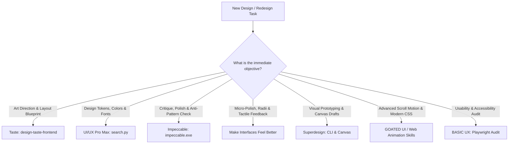

# Master DESIGN Specification & Operating Manual
## Premium Website Design & Frontend Engineering System

This document serves as the central design intelligence, architectural governance, and operating specification for all website design, redesign, and frontend engineering tasks executed within Google Antigravity. It establishes a rigorous, anti-slop standard for creating award-grade, production-ready web interfaces across diverse domains, business models, and tech stacks.

---

## 1. Skill Library Index & Verified Discovery Paths

The following skills are installed and verified within this dedicated skills repository (`D:\skills for ai`) and the global Antigravity configuration. The master workflow dynamically routes tasks to the smallest relevant subset of these capabilities:

| Skill Identifier | Physical Location | Primary Specialization & Core Capabilities | Key Internal References / Assets |
| :--- | :--- | :--- | :--- |
| **`design-taste-frontend`** | `D:\skills for ai\.agents\skills\design-taste-frontend\` | **Art Direction & Anti-Slop:** Distilled from 247 curated Awwwards/One Page Love winners. Provides researched layout directions, asymmetric hero compositions, high-contrast type scales, color palettes, and real browser inspection. | `library/*.json` (directions, heroes, palettes, sections, type)<br>`references/*.md` (tells, critique, imagery, layout)<br>`scripts/inspect.mjs`, `draw.mjs` |
| **`ui-ux-pro-max`** | `D:\skills for ai\.agents\skills\ui-ux-pro-max\` &<br>`~/.gemini/config/skills/ui-ux-pro-max\` | **Design Systems & UI Intelligence:** Comprehensive database containing 79 searchable styles (50 active), 192 product reasoning profiles, 74 typography pairings, 119 UX guidelines, and 25 chart patterns across 22 technology stacks. | `data/*.csv` (styles, colors, typography, ui-reasoning, ux-guidelines, charts)<br>`scripts/search.py` |
| **`impeccable`** | `D:\skills for ai\.agent\skills\impeccable\` | **Craft Floor & Quality Auditing:** Mechanical anti-pattern detection and design refinement. Enforces strict craft standards, typography micro-adjustments, contrast ratios, and persistence of `PRODUCT.md` and `DESIGN.md`. | `reference/craft-floor.md`<br>`reference/new-work.md`<br>`scripts/bin/windows-x64/impeccable.exe` (v4.7.0) |
| **`superdesign`** | `D:\skills for ai\.agents\skills\superdesign\` | **Canvas Exploration & Brand Extraction:** Multi-model design exploration, draft version branching, brand guideline extraction from URLs, and asset generation. | `references/SUPERDESIGN.md`<br>`references/COMPONENTS.md`<br>Global CLI: `superdesign` (v0.14.0) |
| **`make-interfaces-feel-better`** | `D:\skills for ai\.agents\skills\make-interfaces-feel-better\` | **Micro-Polish & Tactile Details:** Engineering guidelines for concentric radii (`outer = inner + padding`), optical alignment, interruptible CSS transitions, stagger animations, layered shadows, tabular numbers, and icon states. | `animations.md`, `surfaces.md`, `typography.md`, `icons.md`, `performance.md` |

### On-Demand Extension Modules (Verified Installation Catalog)
When a project requires specialized capabilities beyond the core quartet, the workflow pulls from these pre-verified sources:
* **Hallmark** (`nutlope/hallmark`): Structural layout variance for landing pages that break out of standard 3-card formulas.
* **GOATED UI** (`flash-hero/GOATED-UI-SKILL` -> `frontend-atlas`): 474 production-tested recipes for GSAP ScrollTrigger, Lenis smooth scroll, SplitText, WebGL, and modern CSS.
* **Web Animation Skills** (`iart-ai/web-animation-skills`): Micro-interactions, 60fps performance FLIP transitions, SVG morphing, and Lottie control.
* **BASIC UX** (`https://basicux.com`): Dual-audience usability scoring (human accessibility + AI web-agent readability) and Playwright audit reporting.
* **Frontend AI Skills** (`JustineBijuPaul/frontend-ai-skills`): Specialized React architecture, Web Vitals optimization, and component test harnesses.

---

## 2. Design Philosophy: Intentional Craft Over AI Slop

Modern AI coding agents gravitate toward the mathematical average of their training data: centered 3-line headlines, faint purple/blue gradient buttons, generic icon triplets, floating frosted glass blobs, uniform 12px rounded cards, and uninspired `Inter` typography. Every decision in this specification is designed to systematically eliminate those defaults.

### Core Principles

1. **The Brief & Idea Win Over Generic Aesthetics:**
   * Design begins with the subject matter, not the styling. An artisanal coffee roaster, a high-frequency fintech engine, an industrial robotics platform, and an editorial magazine demand completely distinct visual languages.
   * Never force every project into a single default (e.g., permanent dark mode, default glassmorphism, or generic neo-brutalism). Match visual tone to audience intent and domain gravity.

2. **Substance Over Artificial Decoration:**
   * Removing ornaments is only half the battle. A minimalist page stripped of cards and gradients that gains nothing in return feels empty and starved.
   * True visual substance comes from:
     * **Heroic Typography:** Purposeful scale jumps where headers make an assertive statement.
     * **Expansive Color Fields:** Confident tonal backgrounds with deliberate contrast ratios.
     * **Authentic Subject Imagery:** Genuine photography, diagrams, product captures, or purposeful vector assets rather than decorative abstract placeholders.
     * **Generous Negative Space:** Spacing that allows content to breathe and establishes unambiguous relationships.

3. **Contextual Operating Modes:**
   Design fidelity must adapt to how the user interacts with the surface:
   * **Persuade (Marketing, Landing Pages, Pricing):** High visual expression, distinctive art direction, brand narrative, and conversion focus.
   * **Operate (Dashboards, Admin, Settings, Complex Tools):** High visual restraint, scannability, dense information hierarchy, keyboard efficiency, and native system patterns.
   * **Read (Documentation, Articles, Knowledge Bases):** Structural clarity, optimal reading column widths (60–75 characters per line), comfortable line heights, and effortless navigation.
   * **Experience (Portfolios, Showcase Features, Immersive Demos):** The artifact leads; UI chrome recedes into the background.

4. **Honest Design Truth:**
   * Never output fake testimonials ("Jane Doe, CEO"), placeholder metrics ("99.9% Faster"), dead buttons, or non-functional fake search inputs in a production deliverable.
   * If copy is missing, use realistic, domain-specific draft content derived from the project analysis rather than meaningless Latin filler.

---

## 3. Mandatory Pre-Flight Project Analysis

Before writing or modifying a single line of frontend code, the agent must perform this 10-point analysis:

1. **Project Purpose & Business Goals:** What conversion, activation, or informational action represents success?
2. **Target Audience & Expectation:** Who is using this product (developers, enterprise executives, consumers, students) and what patterns do they instinctively trust?
3. **Brand Identity & Tone:** What is the brand positioning (luxurious, utilitarian, playful, hyper-technical, minimalist, editorial)?
4. **Existing Codebase & Tech Stack:** Inspect `package.json`, framework configurations (React, Next.js, Vite, Astro, Vue), styling engines (Tailwind CSS, Vanilla CSS, CSS Modules), and installed icon/motion packages.
5. **Existing Routes, Pages & Components:** Map out active pages, layouts, shared headers/footers, and common state wrappers to prevent architectural regressions.
6. **Information Hierarchy & Content Structure:** What is the primary message? What is the secondary proof? What are the tertiary details?
7. **User Journeys & Conversion Funnels:** How does a visitor traverse from landing to signup, checkout, or inquiry?
8. **Functional & Technical Constraints:** Are there legacy browser requirements, mobile-first mandates, SSR constraints, or strictly defined third-party APIs?
9. **Reference Sites & Anti-References:** Analyze provided benchmarks for what to embrace and what clichés to consciously avoid.
10. **Accessibility, Performance & SEO Mandates:** Target WCAG 2.2 AA compliance, Core Web Vitals (LCP < 2.5s, INP < 200ms, CLS < 0.1), and semantic OpenGraph/JSON-LD structure.

> **Assumption Rule:** If any non-critical parameter is unspecified, make a reasonable, domain-appropriate, and documented assumption. Halt for user clarification only if an ambiguity fundamentally alters the project scope or brand identity.

---

## 4. Intelligent Skill Selection Engine

To prevent context bloat, prompt drift, and conflicting instructions, select **only the minimal required toolset** for each specific development phase:



### Conflict Resolution Protocols
When different skills offer contrasting guidance, resolve conflicts using this hierarchy:
1. **The Explicit Project Brief & Brand Archetype Always Wins:** If the client requests a high-density, monochrome technical dashboard, reject any skill recommendation suggesting soft pastel cards.
2. **Accessibility & Usability Outrank Aesthetics:** Any decorative choice that fails WCAG 2.2 AA contrast (4.5:1 for body text, 3:1 for large text/UI components) is immediately vetoed.
3. **Performance Outranks Animation:** Do not attach heavy scroll observers or Three.js canvases if they compromise 60fps rendering or inflate bundle sizes on mobile devices.
4. **Existing Code Architecture Outranks Library Suggestions:** Never rip out Tailwind CSS or React to force an ad-hoc styling library suggested by an external recipe.

---

## 5. Design System Specification Template

Every new website or significant redesign must establish an explicit design system token contract before constructing full pages:

### A. Color Architecture & Semantic Tokens
* **Background Surfaces:**
  * `--surface-base`: The root canvas color.
  * `--surface-raised`: Cards, dropdowns, elevated panels (+2–5% contrast shift from base).
  * `--surface-overlay`: Modals, dialogs, floating popovers.
  * `--surface-sunken`: Inputs, table headers, code blocks (-2–5% contrast shift from base).
* **Text & Content Hierarchy:**
  * `--text-primary`: Uncompromised contrast (minimum 7:1 against base surface).
  * `--text-secondary`: Supporting labels, metadata (minimum 4.5:1 contrast).
  * `--text-tertiary`: Placeholders, subtle borders (never lower than 3:1 for functional elements).
* **Accents & Brand Identifiers:**
  * `--brand-primary`: The primary focal action color.
  * `--brand-secondary`: Supporting accent, hover states, or subtle badges.
  * `--state-error`, `--state-success`, `--state-warning`, `--state-info`: Universal feedback tokens.

### B. Typography & Reading Geometry
* **Font Pairing Philosophy:** Pair an assertive, high-character display typeface with a neutral, highly legible geometric or humanist body face.
* **Scale Ratios:**
  * Hero Headlines: `clamp(2.5rem, 5vw + 1rem, 4.5rem)` with tight tracking (`-0.03em`) and balanced line height (`1.05–1.15`).
  * Section Titles (H2): `clamp(1.75rem, 3vw + 0.5rem, 2.75rem)` with tracking (`-0.02em`).
  * Subheadings (H3): `1.25rem–1.5rem` with normal to slight negative tracking.
  * Body Text: `1rem (16px)` base with line-height `1.5–1.65` and max reading line length of `60–75ch`.
  * Micro / Overline Labels: `0.75rem–0.875rem` uppercase with deliberate tracking (`+0.05em to +0.1em`).

### C. Spacing Rhythms & Grid Layouts
* **Base Unit:** 4px / 8px scale (`4px, 8px, 12px, 16px, 24px, 32px, 48px, 64px, 96px, 128px`).
* **Container Bounds:**
  * Full Page Max Width: `1280px` or `1440px`.
  * Reading Column Max Width: `720px` to `840px`.
  * Grid Structure: Fluid CSS Grid or 12-column layouts with responsive gutters (`16px` mobile, `32px` desktop).

### D. Geometry, Borders & Elevation
* **Corners:** Match the brand archetype:
  * Technical / Editorial / Luxury: Sharp `0px` or subtle `2px–4px`.
  * Modern SaaS / Fintech: Controlled `6px–8px`.
  * Playful / Consumer: Soft `12px–16px` (avoid excessive pill shapes on content containers).
* **Borders & Dividers:** High-precision, subtle borders (`1px solid var(--border-subtle)`). Never use heavy, muddy box shadows when a crisp 1px border achieves superior separation.

---

## 6. Premium UI Anti-Patterns (The "Never Do" List)

The following clichés instantly mark a website as cheap, amateur, or AI-generated:

1. **The Centered Cliché Hero:** A centered, 3-line generic title + purple-gradient pill tag above it + two generic buttons ("Get Started", "Learn More") + floating dashboard mockup screenshot beneath. Break this pattern with asymmetrical layouts, split viewports, editorial typography, or dynamic interactive previews.
2. **The 3-Card Feature Monotony:** Three identical white or dark cards with a colored SVG icon in a rounded square, a bold 3-word title, and two sentences of generic text. Replace with varying bento-grid hierarchies, full-width alternating walkthroughs, or interactive tabs.
3. **Gratuitous Glowing Blobs & Heavy Gradients:** Random radial blur circles floating behind text that decrease contrast and look like a template from 2022.
4. **Mobile Typography Destruction:** Text that looks proportional on a 27-inch monitor but wraps into 12 awkward vertical lines on an iPhone screen because fluid `clamp()` was omitted.
5. **Decorative Dead Ends:** Fake search inputs that do not filter, tabs that do not switch content, or navigation anchors linking to `#` instead of actual sections.
6. **Generic Stock Imagery & 3D Clay Figures:** Generic isometric 3D characters or smiling corporate stock photos. Use real product diagrams, genuine domain photography, or crisp custom SVGs.

---

## 7. Frontend Engineering & Tech Stack Preservation Rules

When translating design into code:

1. **Stack Sanctity:**
   * Never rewrite or replace a project's foundational stack without explicit user approval.
   * If the project runs **React + Vite + Tailwind CSS**, all new markup must use standard React components, Tailwind utility classes, and existing project icons (Lucide, Heroicons, Radix Icons).
2. **Component Architecture:**
   * Keep components modular and single-responsibility.
   * Separate presentational UI primitives (buttons, badges, inputs) from business-logic feature modules (pricing tables, user profile cards).
3. **Comprehensive State Handling:**
   Every dynamic component must natively handle and render:
   * **Default State:** Pristine, ready for user interaction.
   * **Hover & Focus States:** Clear, accessible keyboard focus rings (`focus-visible:ring-2`) and smooth hover transitions (`150ms–200ms ease-out`).
   * **Loading State:** Skeleton loaders or subtle spinners that preserve layout geometry without layout shift.
   * **Empty State:** Helpful onboarding guidance when data arrays are empty.
   * **Error State:** Clear, human-readable inline error notifications with recovery pathways.
   * **Disabled State:** Reduced opacity (`0.5`), disabled cursor (`cursor-not-allowed`), and `aria-disabled="true"`.
4. **Accessibility Primitives:**
   * Always use semantic HTML tags (`<main>`, `<nav>`, `<article>`, `<section>`, `<aside>`, `<header>`, `<footer>`).
   * Never make clickable `<div>` elements; use `<button>` or `<a href="...">` with descriptive text.
   * Ensure interactive icons include an accessible name via `aria-label` or `<span class="sr-only">`.

---

## 8. Motion, Animation & Interaction Protocol

Animation must serve comprehension, spatial continuity, or delight—never ego or decoration.

1. **The Three Tiers of Motion:**
   * **Micro-Interactions (100ms–250ms):** Button presses, dropdown reveals, checkbox toggles. Must feel instantaneous. Use standard CSS transitions on `transform` and `opacity`.
   * **Page & Section Transitions (300ms–500ms):** Modal presentations, drawer slide-outs, tab switches. Use CSS View Transitions or Framer Motion / Motion React.
   * **Storytelling / Scroll Choreography (Context-Driven):** Hero reveals, sequence scrubbers, pinned interactive demos. Use GSAP ScrollTrigger synchronized with Lenis when smooth scroll is required.
2. **Performance Floor:**
   * Animate **only** composite properties: `transform` (translate, scale, rotate) and `opacity`.
   * Never animate `top`, `left`, `width`, `height`, `margin`, `padding`, or `border-width` on scroll or hover (causes continuous browser reflow and layout thrashing).
3. **Accessibility Mandate (`prefers-reduced-motion`):**
   * Wrap all non-essential movement in `@media (prefers-reduced-motion: reduce)`.
   * Provide immediate, instantaneous state changes or subtle opacity fades for users with vestibular sensitivities.
4. **No Scroll Hijacking:**
   * Never manipulate native scroll velocity or override trackpad gestures unless building a specialized, isolated interactive showcase with a clearly designated escape route.

---

## 9. Mandatory Multi-Viewport Visual QA

A design implementation is incomplete until it has been inspected and audited across real viewports.

### Target Viewport Matrix
* **Desktop:** `1440 × 900` (Standard widescreen laptop/monitor layout).
* **Tablet:** `768 × 1024` (Portrait tablet / small laptop navigation fold).
* **Mobile:** `390 × 844` (Modern smartphone viewport).

### Pre-Ship Inspection Checklist
* [ ] **Layout & Overflow:** No horizontal scrollbars appear unintentionally at any viewport width.
* [ ] **Typography Wrapping:** Headlines wrap naturally without single-word orphan lines ("widows").
* [ ] **Interactive Reachability:** Mobile buttons and tap targets meet the minimum `44 × 44px` physical touch area.
* [ ] **Touch vs Hover Parity:** Hover effects do not get stuck or break functionality on mobile touch devices.
* [ ] **Console Cleanliness:** Browser developer tools reveal zero uncaught exceptions, 404 image errors, or missing key warnings.
* [ ] **Contrast Compliance:** All text passes automated contrast checks (minimum 4.5:1 ratio).
* [ ] **Form Resilience:** Inputs accept valid data, highlight invalid fields gracefully, and do not zoom awkwardly on iOS mobile focus (keep input text at least 16px).

---

## 10. Design Iteration Loop

Every website project follows this disciplined, 11-step execution cycle:

```text
  [1. Project Discovery] ──> [2. Art Direction Selection] ──> [3. Skill Toolset Activation]
           │
           ▼
  [4. Design System Definition] ──> [5. Page Blueprint Architecture] ──> [6. Component Implementation]
           │
           ▼
  [7. Rendered Browser Inspection] ──> [8. Impeccable Craft Critique] ──> [9. Defect Remediation]
           │
           ▼
  [10. Cross-Viewport Re-Testing] ──> [11. Final Delivery & Verified Sign-Off]
```

---

## 11. Multi-Archetype Design Guidelines

Apply these domain-tailored blueprints instead of reusing a single template:

| Archetype | Tone & Geometry | Palette Strategy | Typography Strategy | Hero & Layout Pattern |
| :--- | :--- | :--- | :--- | :--- |
| **SaaS & AI Products** | Precision, clarity, reliable, controlled radii (`6px–8px`). | Deep neutral canvas with a single energetic brand accent (indigo, emerald, or amber). High-contrast data surfaces. | Geometric Sans (`Plus Jakarta Sans`, `Geist`, `Inter`) paired with clean mono accents (`JetBrains Mono`). | Asymmetrical split hero: sharp value proposition + interactive live product demonstration. |
| **Agency & Creative Studio** | Expressive, bold, editorial, sharp corners (`0px–2px`), intentional negative space. | Monochromatic base (pure black/white or deep charcoal) with high-impact editorial accents. | High-character Editorial Serif (`Instrument Serif`, `Playfair`, `Fraunces`) paired with grotesque sans (`Space Grotesk`). | Full-bleed typography hero with horizontal project showcases and smooth hover reveals. |
| **E-Commerce & DTC Brand** | Warm, inviting, tactile, image-first, spacious product grids. | Organic neutrals (cream, stone, warm taupe) with subtle nature-grounded tones. | Refined Humanist Sans (`Cabinet Grotesk`, `Satoshi`) or elegant modern serif (`Cinzel`). | Story-driven hero highlighting physical craft, followed by non-uniform editorial product showcases. |
| **Portfolios & Personal Brands** | Authentic, confident, focused, minimal chrome, high-craft finish. | Restrained dual-tone with high contrast. Let the projects supply the color. | Distinctive personal typeface pairing reflecting individuality without sacrificing legibility. | Single-viewport opening statement leading immediately into high-fidelity case study previews. |
| **Dashboards & Enterprise Tools** | Dense, scannable, quiet borders, zero vanity gradients, task-oriented. | System neutral greys (`slate`, `zinc`) with strict functional semantic status colors (green/red/yellow/blue). | High-legibility system UI font stack with tabular numeric figures (`font-variant-numeric: tabular-nums`). | Multi-column collapsible layout with modular metric summaries, filter toolbars, and rich data tables. |

---

## 12. Definition of Done (Completion Gate)

A website design or engineering task is considered **Complete** only when all conditions are satisfied:
1. The implementation reflects a distinct, intentional art direction that fulfills the agreed project brief.
2. All required routes, views, and core components are built with real content and functional states.
3. Multi-viewport testing has verified clean rendering across mobile (`390px`), tablet (`768px`), and desktop (`1440px`).
4. Existing project architectures, routes, APIs, and authentication flows remain completely unbroken.
5. Contrast, semantic markup, and reduced-motion fallbacks meet accessibility standards.
6. The codebase is clean, well-commented, and free of placeholder stubs or unverified claims.
